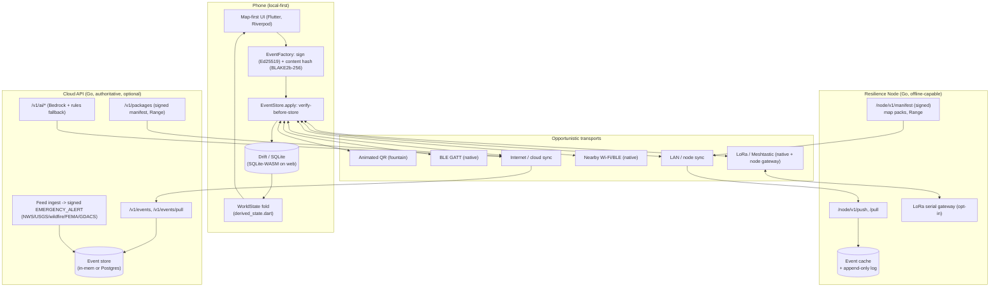

# How it works (one page)

Resilience Network is **local-first**: the phone creates, signs and shows
everything immediately, then distributes it opportunistically over whatever
transport exists. No connection is required; each connection only improves
synchronisation. The rule that governs the whole system and this document: the
UI never claims something works that is not wired - it shows an honest state.

## Architecture + data flow

### Signed events (the one data type)

Every action is a content-addressed, Lamport/DAG-ordered, **Ed25519-signed**
event. The id is `BLAKE2b-256(canonicalHeader(no id) || body)`; the signature is
`Ed25519(canonicalHeader(with id) || body)`. State is derived by **folding** the
log (`app/lib/state/derived_state.dart`), so independent devices converge even
with wrong clocks. Every ingest path - local write, cloud/node pull, QR, BLE,
LoRa - goes through `EventStore.apply`, which verifies signature + hash **before
storing**. A forged or tampered event is rejected everywhere; relays carry
opaque bytes and are never trusted.

### Sync paths

- **Cloud** (`/v1/events`, `/v1/events/pull`): push unsent local events, pull
  new ones; exponential backoff; honest offline handling; visible status.
- **Node** (`/node/v1/push`, `/node/v1/pull`): the same client against a LAN
  node so phones reconcile with no internet.
- **Mesh/nearby/QR/BLE/LoRa**: the `Transport` abstraction
  (`app/lib/transport/transport.dart`) carries signed events over whatever is
  present; large/media events are refused on constrained links rather than
  corrupted.

### Privacy model

- Location is **opt-in**, rounded to ~110 m unless the user picks exact,
  **time-boxed**, **revocable**, and **E2E-encrypted** to the chosen audience
  over the Signal session. The fold never decrypts a coordinate; only the
  authorised viewer resolves the point.
- Messaging is end-to-end (Signal: X3DH + Double Ratchet + sender keys);
  attachments are AES-256-GCM, content-addressed, EXIF-stripped. Relays/cloud
  see only ciphertext.
- Only owners edit their own things; only verified authors issue alerts - enforced in the fold with abuse tests. Logs never record message content,
  keys, or coordinates.

## Transport matrix (works where, Android vs iPhone)

Honest states: **works today** (exercised here by tests + web build),
**needs real device/hardware** (code paths exist, not exercisable in this
sandbox), **not built**. "Headless" means the Flutter UI cannot be driven by
accessible name in this sandbox (no aria-label semantics nodes), so interaction
taps are proven by Dart fold/abuse/widget tests + Go endpoint tests + the
passing web build, not by clicking.

| Transport | Android | iPhone | Web | State / how proven |
| --- | --- | --- | --- | --- |
| Internet / cloud sync | yes | yes | yes | **works today** - `cloud_sync_test.dart`, Go `server_test.go`; web build boots zero-error |
| LAN / node sync | yes | yes | yes (HTTPS node only; mixed content blocks plain-HTTP) | **works today** - node `syncserver` + `packages` tests; `package_manifest_test.dart` |
| Animated QR transfer | yes | yes | camera-dependent | **works today (codec + verify)** - `qr_fountain` + `qr_transfer` tests (loss tolerance, SHA-256 + signature, ingest via `EventStore.apply`); on-camera scan not drivable headlessly |
| BLE GATT | yes | yes | no (browser has no BLE) | **needs real device** - chunker/pairing/encryption unit-tested (`ble_*` + Dart tests); radio behind `flutter_blue_plus`, native-only, not exercised here |
| Nearby (Wi-Fi/BLE) | yes | limited | no | **needs real device** - transport exists (`nearby_transport.dart`); not driven on-device in this run |
| LoRa / Meshtastic | yes (BLE/serial) | yes (BLE) | no | **needs real hardware** - pure-Dart codec/fragmenter tested (`lora_codec`); node Go serial gateway tested from a canned stream; a physical Meshtastic radio is required |
| Estimated (dead-reckoning) position | yes | yes | **unavailable (honest)** | **native-only** - `sensors_plus`; web has no sensor stream and says so |

Android vs iPhone caveats: BLE background and Nearby behave differently per OS
and need entitlements/permissions (declared in the Android manifest and iOS
`Info.plist`); LoRa on iPhone is BLE-only (no USB serial). None of the radios
were exercised here - they need real devices.

## Works today vs needs real device vs not built

| Capability | State | Note |
| --- | --- | --- |
| Signed event log, local DB, fold-driven UI | **works today** | web (SQLite-WASM) + native |
| Cloud + node sync (push/pull, verify-before-store) | **works today** | visible status, backoff, honest offline |
| Connectivity indicator (Online / Cloud unreachable / Node connected / Offline) | **works today** | live banner from `lib/sync/connectivity.dart` |
| Offline service-worker app shell + cacheable cloud headers | **works today** | `app/web/sw.js`, `cloud/internal/api/web.go` (+ `web_test.go`) |
| Map: OSM online + offline raster PMTiles from a node; refresh; fold-driven updates | **works today (raster)** | vector falls back to OSM; `maplibre_gl` not added |
| Auto/last-known location; manual pin; multi-select supplies/needs | **works today** | `location_source` recorded; fold/abuse tests |
| Estimated (dead-reckoning) position | **native-only** | web honestly unavailable |
| Haptics (gated, Settings toggle) | **works today (native)** | web has no haptics |
| Optional identity; reveal-gated Resilience ID + biometric lock + auto-hide | **works today** | `local_auth` behind an authenticator interface; `FakeAuthenticator` in tests |
| Secure messaging (text + photo + audio, E2E) | **works today** | durable Signal store; relays see ciphertext |
| Location sharing (opt-in, ~110 m, time-boxed, revocable, E2E) | **works today** | author-only stop; fold/abuse tests |
| Provider tools (verified supplies, alerts + recall, missions, certify, depth-2) | **works today** | fold + abuse tests |
| Cloud alert feed -> official alerts; `/v1/alerts`; safe-places (sources, no fabrication) | **works today (server)** | feed fixtures + Go tests; worker gated on `FEED_SIGNING_KEY` |
| Prepare-now downloads + resumable chunked download; cloud/node signed packages | **works today (native best)** | web has no persistent partial file (IndexedDB/OPFS only) |
| Animated QR transfer | **works today (codec + verify)** | on-camera scan needs a device |
| BLE / Nearby / LoRa radios | **needs real device/hardware** | code + unit tests exist; no radio here |
| Web Push / VAPID (notifications when tab closed) | **not built** | needs SW push subscription + server push |
| Native local notifications + background polling | **needs real device** | needs a plugin + device; in-app banner covers the open-app case |
| Heroku deploy + live-site click-through | **not done here** | Heroku CLI not authenticated in this sandbox (commands in `docs/OVERNIGHT_LOG.md`) |
| AWS Lambda / CDK (`infra/`) | **off limits / not deployable** | event account denies `iam:CreateRole` |
